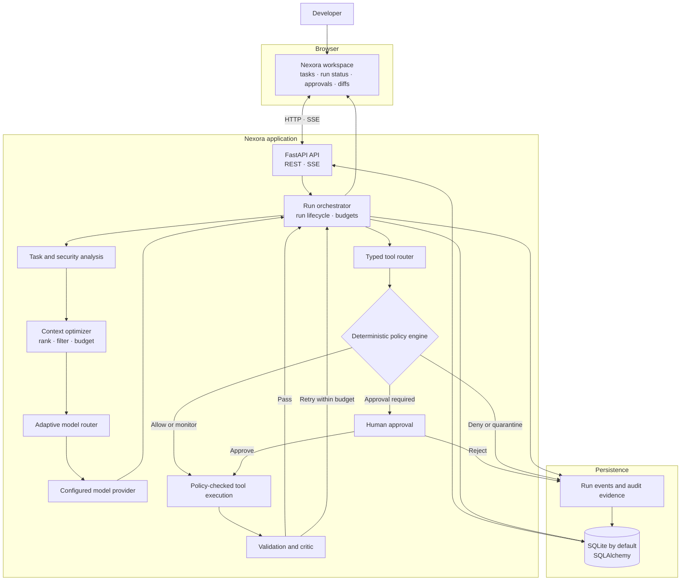
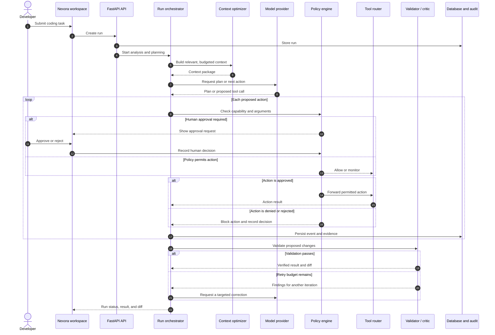

<div align="center">

# Nexora

**Code with evidence.** A security-first AI coding workspace that understands repository context, proposes changes, and validates every run.

[](LICENSE)
[](https://www.python.org/)
[](https://fastapi.tiangolo.com/)
[](https://tokenfactory.nebius.com/)

Built for the **Nebius x NVIDIA Global AI Hackathon** · Coding and Agentic Engineering

</div>

---

## Contents

- [Demo video](#demo-video)
- [Screenshots](#screenshots)
- [What Nexora does](#what-nexora-does)
- [System architecture](#system-architecture)
- [How a run works](#how-a-run-works)
- [Requirements](#requirements)
- [Setup and installation](#setup-and-installation)
- [Configuration](#configuration)
- [Run tests](#run-tests)
- [Repository structure](#repository-structure)
- [License](#license)


## Demo video

<p align="center">
A security-first AI coding workspace that understands repository context, proposes changes, and validates every run.

[**Demo video (3:00)**](https://drive.google.com/file/d/1GUr04nnthh-Tewl4Hc3vIdgiakU30RAS/view?usp=sharing) ·
Built for *Nebius x NVIDIA Global AI Hackathon* ·

<br>

<a href="https://drive.google.com/file/d/1GUr04nnthh-Tewl4Hc3vIdgiakU30RAS/view?usp=sharing" title="Watch the Nexora Demo Video on Google Drive">
  
</a>

<sub>Click to watch the 3:00 demo on Google Drive. </sub>

</div>

The narrated walkthrough shows the running Nexora workspace, its chat and project views, model routing, and appearance controls. It uses an isolated demo database and a scripted local response; no external model is called and no provider quota is used.

## Live Deployment

Nexora is publicly deployed and accessible through the following live application:

<p align="center">
  <a href="https://azizullah-03-nexora-workspace.hf.space/">
    
  </a>
</p>

<p align="center">
  **[Launch Nexora Live](https://azizullah-03-nexora-workspace.hf.space/)**
</p>

The live deployment allows users and evaluators to explore the Nexora coding workspace directly through their browser without requiring local installation or manual configuration.

**Deployment Platform:** Hugging Face Spaces  
**Application:** Nexora AI Coding Workspace  
**Access:** Public Web Deployment

> **Note:** Live inference capabilities depend on the deployment environment and configured model provider credentials. Some features may require valid backend configuration.

## Screenshots

| Screen | Preview |
|---|---|
| Latest workspace | [](nexora/demo/Screenshot%202.png) |
| Live workspace | [](nexora/demo/Nexora%20Live%20demo%202-preview.png) |
| Run plan and progress | _Add `docs/screenshots/run-progress.png`_ |
| Policy decisions and code diff | _Add `docs/screenshots/review-diff.png`_ |

## What Nexora does

Nexora is a coding-agent workspace for small Python repositories. A run analyzes a task, screens it for security risks, selects and budgets relevant code context, prepares a plan, and routes model requests through a provider adapter. Actions pass through a typed tool router and deterministic policy engine; sensitive actions can require human approval. A validation and critic loop checks the resulting changes and keeps run evidence.

- **Repository-aware context:** ranks and budgets source and symbol context instead of sending the entire repository by default.
- **Adaptive inference:** routes tasks according to configured models, capabilities, and task needs. Nebius Token Factory is supported; configure credentials for live provider inference.
- **Policy-gated tools:** explicit allow, monitor, approval, deny, and quarantine decisions protect file and command operations.
- **Validation and evidence:** checks proposed changes and records run events and audit evidence for review.
- **Developer workspace:** browser UI with run status, approvals, code changes, and diff review.

## System architecture



## How a run works



The policy engine is the boundary between model-proposed actions and tool execution. An approval is explicit; a rejection or policy denial is recorded rather than treated as permission.

## Requirements

- Python 3.10 or later
- Git
- Node.js 18+ only if running the frontend JavaScript tests
- A Nebius Token Factory API key for live model inference. Keep provider credentials on the backend; never place them in frontend code.

## Setup and installation

### 1. Clone the repository

```bash
git clone https://github.com/AzizullahMemonAi/Nebius-x-NVIDIA-Global-Al-Hackathon.git
cd Nebius-x-NVIDIA-Global-Al-Hackathon
```
### 2. Create and activate a virtual environment

```bash
# Create virtual environment
python -m venv venv

# Windows Command Prompt:
venv\Scripts\activate.bat

# Windows PowerShell:
venv\Scripts\Activate.ps1

# macOS / Linux:
source venv/bin/activate
```

### 3. Install dependencies

```bash
pip install -r nexora/backend/requirements.txt
```

### 4. Configure the application

Copy the application template to `nexora/.env`:

```powershell
# Windows PowerShell
Copy-Item nexora\.env.example nexora\.env
```

```bash
# macOS / Linux
cp nexora/.env.example nexora/.env
```

Set `NEBIUS_API_KEY` in `nexora/.env` to enable live model inference. SQLite is the default database; no separate database server is required for local development. Do not commit `.env` files or real API keys.

### 5. Start the backend

```bash
python -m uvicorn nexora.backend.app.main:app --host 127.0.0.1 --port 8001
```

### 6. Start the frontend

In a second terminal, from the repository root:

```bash
python scripts/dev_server.py --port 3000 --api-port 8001
```

Open **http://127.0.0.1:3000**. The API documentation is available at **http://127.0.0.1:8001/docs** and the health endpoint at **http://127.0.0.1:8001/api/v1/health**.

On Windows, `run_project.bat` is also available as a convenience launcher; it may stop processes listening on ports 3000 and 8001 before starting the application. Review the script before using it if those ports are needed by other applications.

## Configuration

The main settings are read from `nexora/.env` (or `nexora/backend/.env`) and can also be supplied as environment variables:

| Variable | Purpose |
|---|---|
| `NEBIUS_API_KEY` | Nebius Token Factory credential for live inference |
| `NEBIUS_BASE_URL` | Provider API base URL |
| `DATABASE_URL` | Database connection; defaults to local SQLite |
| `ALLOWED_ORIGINS` | Comma-separated CORS origins |
| `DEFAULT_BUDGET_PROFILE` | Default run budget profile |
| `ENVIRONMENT` / `SECRET_KEY` | Runtime environment and signing secret; production requires a non-empty secret |

See [`nexora/.env.example`](nexora/.env.example) for the complete template and [`nexora/backend/config/settings.py`](nexora/backend/config/settings.py) for supported settings.

## Run tests

Run the backend tests from the repository root:

```bash
python -m pytest tests
```

Run the frontend tests (Node.js required):

```bash
node --test nexora/frontend/test/*.test.mjs
```

## Repository structure

```
Nebius-x-NVIDIA-Global-Al-Hackathon/
│
├── nexora/
│   ├── demo/                  # Live product walkthrough and README preview
│   ├── backend/
│   │   ├── app/
│   │   │   ├── api/             # FastAPI routes
│   │   │   ├── core/            # Policy, routing, context, security, and tools
│   │   │   ├── models/          # SQLAlchemy data models
│   │   │   ├── schemas/         # Pydantic request/response schemas
│   │   │   ├── worker/          # Run orchestration and validation lifecycle
│   │   │   └── main.py          # FastAPI application
│   │   ├── config/              # Runtime settings and policy configuration
│   │   └── requirements.txt
│   ├── database/                # PostgreSQL and SQLite schema definitions
│   └── frontend/
│       ├── index.html           # Browser workspace
│       ├── js/                  # Frontend modules and UI components
│       ├── styles/              # Themes and design system
│       └── test/                # Node.js frontend tests
├── scripts/
│   ├── dev_server.py            # Static server and local API proxy
│   └── generate_pdf_doc.py      # Architecture-document generator
├── tests/                       # Backend tests
├── seed_demo_data.py            # Local demo-data setup
├── run_project.bat              # Optional Windows launcher
├── stop_project.bat             # Windows shutdown helper
├── .env.example                 # Root environment template
└── LICENSE
```

## License

Distributed under the MIT License. See [`LICENSE`](LICENSE) for details.
