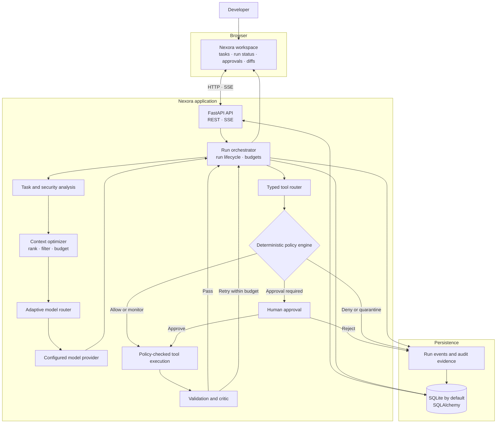
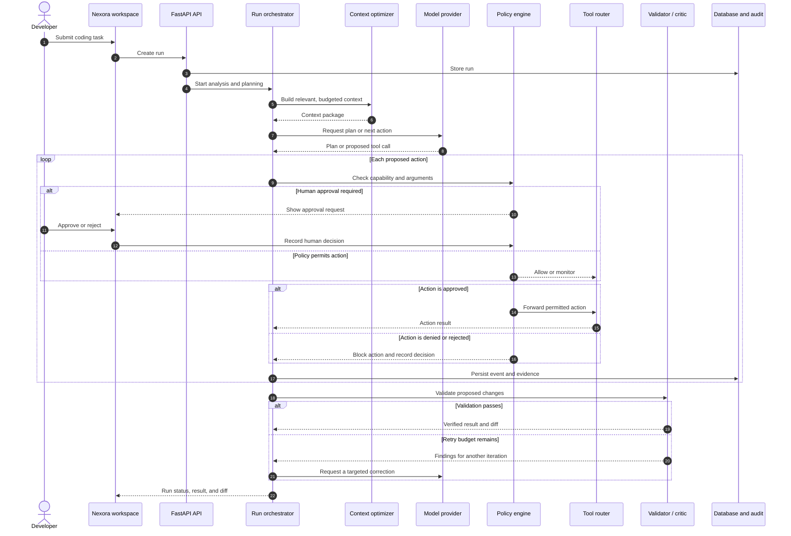

<div align="center">

# Nexora

**Code with evidence.** A secure, token-efficient coding agent for small Python repositories.

Built for the **Nebius x NVIDIA Global AI Hackathon** · Coding and Agentic Engineering

</div>

## Overview

Nexora analyzes coding tasks, screens inputs for security risks, selects relevant code through a ranked and budgeted context pipeline, produces a plan, and routes model requests through a provider adapter. Proposed actions pass through a typed tool router and deterministic policy boundary; sensitive operations can require human approval. A validation loop checks changes and presents the diff and run evidence for review.

## Demo video

<p align="center">
  <video controls width="820" poster="demo/Nexora%20Live%20demo%202-preview.png"
         aria-label="Watch the Nexora live product demo">
    <source src="https://raw.githubusercontent.com/AzizullahMemonAi/Nebius-x-NVIDIA-Global-Al-Hackathon/main/nexora/demo/Nexora%20Live%20demo%202.mp4"
            type="video/mp4">
    <a href="demo/Nexora%20Live%20demo%202.mp4">Open or download the Nexora live demo</a>
  </video>
</p>

The narrated walkthrough shows the running Nexora workspace, its chat and project views, model routing, and appearance controls. It uses an isolated demo database and a scripted local response; no external model is called and no provider quota is used.

## Screenshots

| Screen | Screenshot |
|---|---|
| Live workspace | [](demo/Nexora%20Live%20demo%202-preview.png) |
| Run plan and progress | _Add `docs/screenshots/run-progress.png`_ |
| Policy decisions and code diff | _Add `docs/screenshots/review-diff.png`_ |

## Key Features

### 🔒 Security First
- **Security Invariant**: The model never receives unrestricted host access. Every file read, write, command, network request, and Git operation crosses the Tool Router and Policy Engine.
- **Policy Engine**: Deterministic decisions (ALLOW, ALLOW_WITH_MONITORING, REQUIRE_APPROVAL, DENY, QUARANTINE) with fail-closed behavior.
- **Approval Manager**: Scoped, expiring approvals - silence is NEVER approval.
- **Injection Detection**: Heuristic detection of prompt injection in repository content (advisory only).
- **Secret Protection**: No raw secrets in prompts, logs, or artifacts. Automatic redaction.

### ⚡ Token Efficiency
- **Context Optimizer**: Indexes, ranks, budgets, compresses, and caches repository context.
- **Efficiency Invariant**: Full repository never sent to model by default.
- **Cache**: Repository summaries, file/symbol summaries, normalized tool results, test results.

### 🤖 Adaptive Routing
- **Model Router**: Auto/fixed mode with visible routing reasons.
- **Provider Adapter**: Normalized OpenAI-compatible calls to Nebius/NVIDIA with timeouts, backoff, idempotency.
- **Candidate Tiers**: Nemotron Nano (simple), Super (moderate), Ultra (complex) - enabled after verification.

### 🧪 Validation & Evidence
- **Validator/Critic**: Layered checks (patch applies, syntax, lint, targeted tests, broader tests, security regression, diff review).
- **Loop Detection**: Stops repeated failed actions (threshold: 2 in demo, 3 in standard).
- **Audit Log**: Append-only, hash-chained record of every decision and action.
- **Evidence Export**: Downloadable run reports with policy decisions, test results, and limitations.

## System architecture



## How a run works



## Quick Start

### Prerequisites
- Python 3.11+
- A rotated Nebius API key for hosted model inference (optional for local demo tasks)

### Run Locally

```bash
# From the repository root
python -m venv venv
venv\Scripts\activate  # Windows; use source venv/bin/activate on macOS/Linux
pip install -r nexora/backend/requirements.txt
copy nexora\.env.example nexora\.env
```

Set `NEBIUS_API_KEY` in `nexora/.env` after rotating any key shared in chat or source control. Keep provider keys on the backend; never add them to frontend JavaScript.

Start the backend and the single-origin frontend/API proxy in separate terminals:

```bash
python -m uvicorn nexora.backend.app.main:app --host 127.0.0.1 --port 8001
python scripts/dev_server.py --port 3000 --api-port 8001
```

Open `http://127.0.0.1:3000`. The database and demo records initialize automatically at backend startup.

## Configuration

### Budget Profiles
Two profiles are included by default:
- **demo**: 10 steps, 20 tool calls, 1 retry, 300s timeout, 8K input / 2K output tokens
- **standard**: 40 steps, 80 tool calls, 3 retries, 900s timeout, 50K input / 12K output tokens

In the **demo** profile, basic calculator requests use a local Python starter
and the normal policy-checked repository-write and validation flow; they do
not require a provider API key. Other tasks use the configured model provider.

### Model Registry
Nebius Token Factory models must be registered and enabled after verification:
```sql
INSERT INTO model_registry (model_id, display_name, provider, tier, context_capacity, max_output_tokens, supports_tools, supports_reasoning, is_enabled, verification_date, terms_reviewed)
VALUES ('deepseek-ai/DeepSeek-R1-0528', 'DeepSeek R1 0528', 'nebius', 'ultra', 128000, 4096, true, true, true, NOW(), true);
```

### Policy Configuration
Policies are defined in `backend/config/policies.yaml`:
- Protected paths
- Denied/allowed commands
- Approval-required capabilities
- Monitoring capabilities

## API Endpoints

### Workspaces
- `GET /api/v1/workspaces` - List workspaces
- `POST /api/v1/workspaces` - Create workspace
- `GET /api/v1/workspaces/{id}` - Get workspace
- `PATCH /api/v1/workspaces/{id}` - Update workspace
- `DELETE /api/v1/workspaces/{id}` - Delete workspace

### Runs
- `POST /api/v1/runs` - Create run (analyzes task, creates plan)
- `GET /api/v1/runs` - List runs
- `GET /api/v1/runs/{id}` - Get run details
- `POST /api/v1/runs/{id}/start` - Start/continue run (accept plan)
- `POST /api/v1/runs/{id}/approve` - Approve/reject action
- `POST /api/v1/runs/{id}/cancel` - Cancel run

### Models & Profiles
- `GET /api/v1/models` - List enabled models
- `GET /api/v1/budget-profiles` - List budget profiles

## Run Lifecycle

```
QUEUED → ANALYZING → SECURITY_REVIEW → PLANNING → AWAITING_START
                                                    │
                                                    ▼
┌─────────────────────────────────────────────────────────────┐
│  EXECUTION LOOP                                             │
│  CONTEXT_BUILD → MODEL_STEP → POLICY_CHECK → EXECUTING      │
│       │              │              │            │           │
│       ▼              ▼              ▼            ▼           │
│  (build)        (infer)        (policy)      (sandbox)      │
│                                              │               │
│                                              ▼               │
│                                        VALIDATING           │
│                                              │               │
│                              ┌───────────────┴────────────┐  │
│                              ▼                           ▼  │
│                         PASSED                        FAILED  │
│                              │                           │    │
│                              ▼                           ▼    │
│                         COMPLETED              REPLANNING ◄──┘    │
│                                                          │        │
│                                                          ▼        │
│                          (budget exhausted?) → FAILED/BLOCKED     │
└──────────────────────────────────────────────────────────────┘
```

## Development

### Project Structure
```
nexora/
├── backend/
│   ├── app/
│   │   ├── api/           # FastAPI routes
│   │   ├── core/          # Core components (policy, security, context, etc.)
│   │   ├── models/        # SQLAlchemy models
│   │   ├── schemas/       # Pydantic schemas
│   │   ├── services/      # Business logic services
│   │   ├── worker/        # Background worker/orchestrator
│   │   └── main.py        # FastAPI app entry
│   ├── config/            # Configuration
│   └── requirements.txt
├── frontend/
│   ├── styles/            # CSS (tokens, main)
│   ├── js/                # JavaScript (api, state, components, app)
│   └── index.html
├── database/
│   ├── schema.sql         # PostgreSQL schema
│   └── migrate.py         # Migration script
```

### Adding a New Tool
1. Add tool to `ToolName` enum in `backend/app/core/tools.py`
2. Add schema to `TOOL_SCHEMAS`
3. Add capability mapping to `TOOL_CAPABILITIES`
4. Implement execution in `LocalSandboxAdapter`
5. Add policy rules in `config/policies.yaml`

### Running Tests
```bash
cd nexora/backend
pytest -v --cov=nexora.backend.app
```

## Hackathon Compliance

This project follows the Nexora policy from the hackathon requirements:
- ✅ Real provider integration (Nebius/NVIDIA)
- ✅ Real sandbox execution (Token Factory)
- ✅ Deterministic policy engine
- ✅ Scoped, expiring approvals
- ✅ Hash-chained audit log
- ✅ No unrestricted shell execution
- ✅ No API keys in frontend
- ✅ No silent model switching
- ✅ No fallback services that break integration
- ✅ Evidence register (E01-E11)

## License

MIT License - See LICENSE file for details.

## Acknowledgments

Built for the **Nebius x NVIDIA Global AI Hackathon** using:
- NVIDIA Nemotron models via Nebius
- Token Factory Sandboxes
- FastAPI, SQLAlchemy, PostgreSQL
- Research from the Secure Token-Efficient Autonomous Coding Agent architecture
